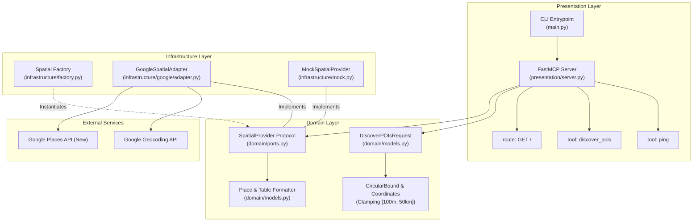
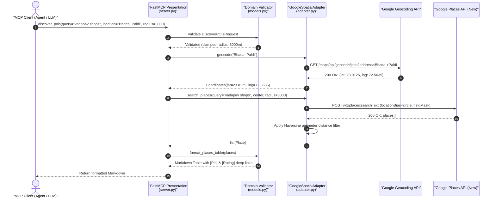
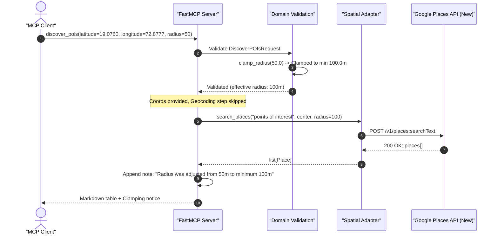
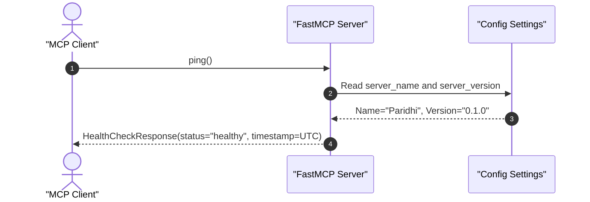
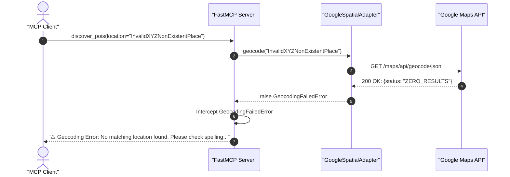

# Paridhi (परिधि)

[](https://www.python.org/downloads/)
[](https://github.com/jlowin/fastmcp)
[](https://github.com/astral-sh/ruff)
[](https://mypy-lang.org/)
[](https://opensource.org/licenses/MIT)

**Paridhi** (*परिधि* — Sanskrit for *perimeter*, *circumference*, or *boundary*) is a [Model Context Protocol (MCP)](https://modelcontextprotocol.io/) server built with Python and [FastMCP](https://github.com/jlowin/fastmcp). It enables AI agents to discover, filter, and enrich local points of interest (POIs) within circular spatial bounds using Google Maps Platform (Geocoding API & Places API New).

---

## Key Highlights

- 🎯 **Circular Spatial Perimeters**: Enforces strict radial boundaries and haversine perimeter filtering.
- 🛡️ **Predictable Clamping**: Automatically bounds search radii to `[100m, 50,000m]` to guard against accidental massive geofences.
- 📐 **Hexagonal / Ports & Adapters Architecture**: Decouples domain logic from external geospatial providers (Google Maps, Mock, Mapbox, OSM).
- 💰 **Billing Optimization**: Uses explicit Google Places API (New) Field Masks (`X-Goog-FieldMask`) to only retrieve required fields.
- 🔗 **Deep-Linked Results**: Formats results as rich Markdown tables with deep links to Google Maps pins and verified ratings.
- 🚦 **Fault Resilient**: Gracefully intercepts quotas, missing locations, and network errors into clean Markdown notices without leaking stack traces.
- 🤖 **Agent-First Governance**: Strict automated synchronization contract between `AGENTS.md` and `README.md`.

---

## Architecture & Ports & Adapters Design

Paridhi is designed around **Clean Architecture / Ports & Adapters (Hexagonal)**:



---

## Use Case Sequence Diagrams

All diagrams use standard Mermaid syntax and render natively on the GitHub Web UI.

### 1. POI Discovery via Informal Location String
This is the standard flow when an agent queries for places near a neighborhood or landmark name.



---

### 2. Direct Coordinate Search with Automatic Radius Clamping
When coordinates are directly provided, geocoding is bypassed. If a requested radius falls outside allowable boundaries, Paridhi safely clamps it.



---

### 3. Server Health Verification (`ping`)



---

### 4. Upstream Error Handling & Graceful Recovery
Paridhi shields the agent and host LLM from unhandled API exceptions and raw HTML error pages.



---

## Project Structure

```text
paridhi/
├── .dockerignore                               # Files excluded from Docker container builds
├── .env.example                                # Environment configuration template
├── .gitignore                                  # Git ignore rules
├── .python-version                             # Python runtime pinned (3.14)
├── Dockerfile                                  # Production multi-stage OCI container image definition
├── pyproject.toml                              # Dependencies, packaging & tool configs
├── uv.lock                                     # Deterministic dependency lockfile
├── LICENSE                                     # MIT License definition
├── RELEASE.md                                  # Release lifecycle & CI/CD deployment guide
├── README.md                                   # User documentation (this file)
├── AGENTS.md                                   # AI Agent operational contracts & SOPs
├── src/
│   └── paridhi/
│       ├── __init__.py                         # Public package exports
│       ├── py.typed                            # PEP 561 typing marker
│       ├── main.py                             # CLI runner (stdio, http, sse transports)
│       ├── core/
│       │   ├── __init__.py
│       │   └── config.py                       # pydantic-settings configuration
│       ├── domain/
│       │   ├── __init__.py
│       │   ├── exceptions.py                   # Typed domain error hierarchy
│       │   ├── models.py                       # Place, Coordinates, Bounds, Table formatter
│       │   └── ports.py                        # SpatialProvider abstract interface
│       ├── infrastructure/
│       │   ├── __init__.py
│       │   ├── factory.py                      # SpatialProvider dependency injection factory
│       │   ├── mock.py                         # Mock provider with realistic offline fixtures
│       │   └── google/
│       │       ├── __init__.py
│       │       ├── adapter.py                  # Google Geocoding & Places API (New) adapter
│       │       └── client.py                   # Client aliases
│       └── presentation/
│           ├── __init__.py
│           └── server.py                       # FastMCP server & registered tool handlers
└── tests/
    ├── __init__.py
    ├── test_config.py                          # Configuration parsing tests
    ├── test_domain_models.py                   # Spatial validation, Place entity, and table formatting
    ├── test_google_adapter.py                  # Unit tests for Google adapter (mocked HTTP)
    ├── test_server.py                          # End-to-end FastMCP tool tests (discover_pois, ping, root)
    └── test_docs_sync.py                       # Continuous documentation synchronization check
```

---

## Getting Started

Paridhi uses **`uv`** exclusively for dependency resolution, virtual environment management, and builds.

### Prerequisites
- Python 3.11+
- [`uv`](https://docs.astral.sh/uv/) (v0.11+)
- Google Maps Platform API Key (with *Geocoding API* and *Places API (New)* enabled)

### Installation

```bash
git clone https://github.com/anshulpatel25/paridhi.git
cd paridhi
uv sync --all-groups
```

### Configuration

Copy the sample environment file:

```bash
cp .env.example .env
```

Edit `.env` to configure your credentials:

```env
# Geospatial Provider ('google' or 'mock')
PARIDHI_SPATIAL_PROVIDER=google

# Google Maps Platform API Key
GOOGLE_MAPS_API_KEY=AIzaSyYourActualGoogleMapsApiKey

# Transport & Network Options
PARIDHI_TRANSPORT=http
PARIDHI_HOST=0.0.0.0
PARIDHI_PORT=8000
```

*(Tip: For offline development or unit testing without an API key, set `PARIDHI_SPATIAL_PROVIDER=mock`)*

---

## Running the Server

### 1. Streamable HTTP (Default for Web & Remote Agent Clients)

```bash
uv run paridhi --transport http --host 0.0.0.0 --port 8000
```
Server endpoint will be accessible at: `http://localhost:8000/mcp`.
Informational landing page at: `http://localhost:8000/`.

### 2. Standard I/O (Local Process for Claude Desktop & Antigravity CLI)

```bash
uv run paridhi --transport stdio
```

To configure in **Claude Desktop** (`claude_desktop_config.json`) or **Antigravity CLI** (`~/.gemini/config/mcp_config.json`):

```json
{
  "mcpServers": {
    "paridhi": {
      "command": "uv",
      "args": [
        "--directory",
        "/absolute/path/to/paridhi",
        "run",
        "paridhi",
        "--transport",
        "stdio"
      ],
      "env": {
        "GOOGLE_MAPS_API_KEY": "AIzaSyYourActualGoogleMapsApiKey",
        "PARIDHI_SPATIAL_PROVIDER": "google"
      }
    }
  }
}
```

### 3. Docker Container (Production Deployment)

Paridhi includes a multi-stage, rootless Dockerfile leveraging `uv` layer caching, healthcheck probe, and OCI standard metadata.

#### Build the image:
```bash
# Build with default version (0.1.0)
docker build -t paridhi:latest .

# Build with an explicit version input
docker build --build-arg VERSION=0.1.0 -t paridhi:0.1.0 .
```

For complete CI/CD release lifecycle and automated GitHub Container Registry workflows, refer to [`RELEASE.md`](./RELEASE.md).

#### Run the container:
```bash
docker run -d \
  --name paridhi \
  -p 8000:8000 \
  -e GOOGLE_MAPS_API_KEY="AIzaSyYourActualGoogleMapsApiKey" \
  -e PARIDHI_SPATIAL_PROVIDER="google" \
  paridhi:latest
```

#### Verify health:
The container includes a native Docker `HEALTHCHECK` querying the lightweight `GET /` operational route:
```bash
curl -f http://localhost:8000/
# {"status":"operational","service":"Paridhi","version":"0.1.0",...}
```

#### Docker Compose Example:
```yaml
services:
  paridhi:
    build: .
    image: paridhi:latest
    ports:
      - "8000:8000"
    environment:
      - GOOGLE_MAPS_API_KEY=${GOOGLE_MAPS_API_KEY}
      - PARIDHI_SPATIAL_PROVIDER=google
      - PARIDHI_TRANSPORT=http
      - PARIDHI_HOST=0.0.0.0
      - PARIDHI_PORT=8000
    restart: unless-stopped
```

---

## Exposed MCP Tools

### `ping`
Verifies server health and returns the current operational status.

- **Parameters:** None `{}`
- **Example Response:**
  ```json
  {
    "status": "healthy",
    "service": "Paridhi",
    "version": "0.1.0",
    "timestamp": "2026-10-03T12:45:00Z"
  }
  ```

---

### `discover_pois`
Discovers and enriches points of interest (POIs) within circular spatial bounds using real-world geospatial data.

#### Parameters:
| Name | Type | Default | Description |
| :--- | :--- | :--- | :--- |
| `query` | `str` | `"points of interest"` | Search term, cuisine, or place category (e.g. `"vadapav shops"`, `"coffee"`, `"hospitals"`). |
| `location` | `str \| null` | `null` | Informal address, landmark, or neighborhood (e.g. `"Bhatta, Paldi"`). Resolved via Geocoding API. |
| `latitude` | `float \| null` | `null` | Direct center latitude `[-90.0, 90.0]`. |
| `longitude` | `float \| null` | `null` | Direct center longitude `[-180.0, 180.0]`. |
| `radius_meters` | `float` | `1000.0` | Search radius in meters. Automatically clamped between `100m` and `50,000m`. |
| `limit` | `int` | `20` | Maximum results to retrieve (`1` to `20`). |

*(Note: Either `location` or both `latitude` and `longitude` must be provided.)*

#### Example Prompt:
> *"Discover top vadapav shops within 3000m of 'Bhatta, Paldi'"*

#### Formatted Markdown Output:
```markdown
### Discovered 'vadapav shops' within 3000m of 'Bhatta, Paldi'

| Place Name | Address | Google Map location | Google Ratings |
| :--- | :--- | :--- | :--- |
| **Jay Bhavani Vadapav** | Paldi Cross Road, Paldi, Ahmedabad, Gujarat 380007 | [Pin](https://maps.google.com/?cid=123456789012345) | [4.3 ★ (2,450)](https://maps.google.com/?cid=123456789012345) |
| **Shreeji Krupa Bombay Vadapav** | Near Bhatta Circle, Paldi, Ahmedabad, Gujarat 380007 | [Pin](https://maps.google.com/?cid=234567890123456) | [4.5 ★ (1,820)](https://maps.google.com/?cid=234567890123456) |
| **Gajanand Pauva & Vadapav Center** | Fatehpura Road, Near Bhatta, Paldi, Ahmedabad 380007 | [Pin](https://maps.google.com/?cid=345678901234567) | [4.1 ★ (940)](https://maps.google.com/?cid=345678901234567) |
| **Karnavati Dabeli & Vadapav** | Mahalaxmi Cross Road, Paldi, Ahmedabad, Gujarat 380007 | [Pin](https://maps.google.com/?cid=456789012345678) | [4.2 ★ (1,150)](https://maps.google.com/?cid=456789012345678) |
```

---

## Continuous Documentation Maintenance

> [!IMPORTANT]
> To ensure documentation never drifts from code behavior, Paridhi maintains an automated contract:
> 1. All AI agents working in this repository are bound by the instructions in [`AGENTS.md`](./AGENTS.md).
> 2. Whenever tools, parameters, providers, or configurations are **added, modified, or removed**, both `README.md` and `AGENTS.md` must be updated concurrently.
> 3. An automated test (`tests/test_docs_sync.py`) validates that all registered FastMCP tools are documented in both `README.md` and `AGENTS.md`.

---

## Testing & Quality Control

Execute all verification checks locally via `uv`:

```bash
# Run pytest test suite (including docs synchronization test)
uv run pytest

# Check code formatting & linting
uv run ruff check .
uv run ruff format --check .

# Strict type analysis
uv run mypy src tests
```

---

## License

This project is licensed under the [MIT License](./LICENSE) - see the [LICENSE](./LICENSE) file for details.
