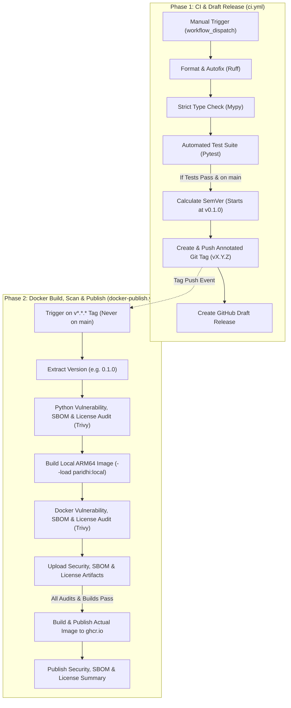

# Release & Deployment Guide for Paridhi

This document outlines the release process, versioning lifecycle, and CI/CD automation designed for **Paridhi**.

---

## 1. Overview of Release Architecture

Paridhi adopts a deterministic, two-phase CI/CD architecture powered by GitHub Actions:



---

## 2. Release Workflows

### Phase 1: Continuous Integration & Draft Release (`.github/workflows/ci.yml`)

> [!NOTE]
> **Manual Execution Policy**: This workflow runs **strictly on manual trigger (`workflow_dispatch`)** from the GitHub Actions web UI or via the GitHub CLI. It does not run on arbitrary push or pull request events.

1. **Code Formatting & Autofix**:
   - Runs `uv run ruff format .` and `uv run ruff check --fix .`.
   - When executed on `main`, any auto-formatting changes are committed and pushed back automatically (`[skip ci]`).
2. **Linting & Type Analysis**:
   - Verifies all lint rules with `uv run ruff check .`.
   - Enforces strict static typing across `src` and `tests` with `uv run mypy src tests`.
3. **Automated Testing Gate**:
   - Executes the complete test suite including unit, integration, and documentation synchronization tests via `uv run pytest`.
4. **Semantic Versioning & Draft Release**:
   - **Only runs if all tests pass, and strictly on the `main` branch**.
   - Inspects existing Git tags matching `v[0-9]*.[0-9]*.[0-9]*`.
   - If no release tags exist, bootstraps the version at **`0.1.0`** (`v0.1.0`).
   - If tags exist, analyzes commit messages since the last release tag:
     - `BREAKING CHANGE:` or `feat!:` / `fix!:` $\rightarrow$ Increments **MAJOR** (`1.0.0`)
     - `feat:` or `feat(...):` $\rightarrow$ Increments **MINOR** (`0.2.0`)
     - `fix:`, `chore:`, `docs:`, `refactor:` $\rightarrow$ Increments **PATCH** (`0.1.1`)
   - Checks if `HEAD` is already tagged to prevent duplicate tags.
   - Creates an annotated Git tag (`vX.Y.Z`) and pushes it to GitHub.
   - Generates a **GitHub Draft Release** with auto-generated release notes using the GitHub CLI (`gh release create --draft`).

---

### Phase 2: Docker Image Build & Publishing (`.github/workflows/docker-publish.yml`)

> [!IMPORTANT]
> **Isolated Trigger Policy**: Docker images are built and published **only when a release tag is pushed (`v*.*.*`)**, never directly on pushes to the `main` branch.

1. **Tag Trigger**:
   - Triggers automatically upon pushing a tag matching `v[0-9]+.[0-9]+.[0-9]+`.
   - Can also be manually dispatched (`workflow_dispatch`) with a custom tag input.
2. **Version Extraction & Input Injection**:
   - Strips the leading `v` from the tag (e.g., `v0.1.0` $\rightarrow$ `0.1.0`).
   - Passes the version number into Docker build as `--build-arg VERSION=<version>`.
   - Sets the runtime environment variable `PARIDHI_SERVER_VERSION=<version>` and OCI image label `org.opencontainers.image.version=<version>`.
3. **Python Package Security, SBOM & License Audit**:
   - Installs project dependencies via `uv sync --all-groups`.
   - Invokes [`aquasecurity/trivy-action@master`](https://github.com/aquasecurity/trivy-action) to scan Python dependencies for known vulnerabilities (`CRITICAL,HIGH,MEDIUM,LOW`).
   - Generates a Software Bill of Materials (SBOM) for Python packages in SPDX 2.3 JSON format (`sbom-python.spdx.json`).
   - Audits open-source licenses for all installed Python packages (`trivy-python-license.txt`).
4. **Local ARM64 Image Build for Pre-Publish Verification**:
   - Sets up QEMU and Docker Buildx for `linux/arm64`.
   - Builds the ARM64 image locally with `--load` (`paridhi:local`).
5. **Container Security, SBOM & License Audit**:
   - Invokes Trivy against the local container image (`paridhi:local`) for vulnerabilities.
   - Generates a Software Bill of Materials (SBOM) for the container image in SPDX 2.3 JSON format (`sbom-docker.spdx.json`).
   - Audits system and container package licenses (`trivy-docker-license.txt`).
   - Uploads all SBOMs and vulnerability/license reports as workflow artifacts.
6. **Build & Publish Actual Image to Container Registry**:
   - Authenticates against GitHub Container Registry (`ghcr.io`) using `GITHUB_TOKEN`.
   - Builds and publishes the verified **ARM64** image (`linux/arm64`) to `ghcr.io`, leveraging cached Buildx layers.
   - Publishes images tagged as:
     - `ghcr.io/<owner>/paridhi:<version>` (e.g. `0.1.0`)
     - `ghcr.io/<owner>/paridhi:<tag>` (e.g. `v0.1.0`)
     - `ghcr.io/<owner>/paridhi:latest`
7. **Comprehensive GitHub Actions Run Summary**:
   - Generates an executive Markdown report directly in the GitHub Actions run summary (`$GITHUB_STEP_SUMMARY`), presenting build metadata, Python package vulnerability/SBOM/license reports, and container vulnerability/SBOM/license findings.

---

## 3. How the Code Accepts Version as Input

Paridhi accepts the version number at multiple operational layers:

### A. Docker Build Argument & Environment Variable
When building or running the container image:

```bash
# Build with a custom version input
docker build --build-arg VERSION=0.1.0 -t paridhi:0.1.0 .

# Run with an environment override
docker run -d -p 8000:8000 -e PARIDHI_SERVER_VERSION=0.1.0 paridhi:0.1.0
```

### B. Command-Line Interface (CLI)
When running the binary or entrypoint locally:

```bash
# Check version
uv run paridhi --version
# Output: paridhi 0.1.0

# Override version at runtime
uv run paridhi --server-version 0.1.0 --transport http --port 8000
```

### C. Programmatic Configuration
When embedding Paridhi in tests or custom runners:

```python
from paridhi.core.config import Settings
from paridhi.presentation.server import create_server

settings = Settings(server_version="0.1.0")
server = create_server(settings=settings)
```

The version is surfaced through the health check tool `ping()` and the root informational endpoint `GET /`:

```json
{
  "service": "Paridhi",
  "version": "0.1.0",
  "status": "operational",
  "mcp_endpoint": "/mcp"
}
```

---

## 4. Maintainer Release Workflow

To execute a release:

1. **Commit and Push Changes to `main`**:
   ```bash
   git add .
   git commit -m "feat: add support for custom spatial filters"
   git push origin main
   ```
2. **Trigger CI & Release Pipeline Manually**:
   - In GitHub: Navigate to **Actions** $\rightarrow$ **CI & Release Pipeline** $\rightarrow$ Click **Run workflow** (select `main` branch, ensure `Draft a new release` is checked).
   - Via GitHub CLI:
     ```bash
     gh workflow run ci.yml --ref main
     ```
   - Formatting is verified/corrected, tests execute, the next SemVer tag (e.g. `v0.2.0`) is pushed, and a GitHub Draft Release is drafted.
3. **Review & Publish Draft Release**:
   - Navigate to **GitHub $\rightarrow$ Releases** (`https://github.com/<owner>/paridhi/releases`).
   - Open the latest draft release.
   - Review release notes, edit descriptions if desired, and click **Publish release**.
4. **Automatic Local Scan, Container Build & Publishing**:
   - The tag push triggers `Build and Publish Docker Image`.
   - Runs Aquasecurity Trivy on Python dependencies and the local ARM64 container (`paridhi:local`), producing vulnerability reports, SPDX 2.3 JSON SBOMs (`sbom-python.spdx.json`, `sbom-docker.spdx.json`), and open-source license audits (`trivy-python-license.txt`, `trivy-docker-license.txt`).
   - Builds and publishes the verified ARM64 image to `ghcr.io`, leveraging cached Buildx layers, and publishes the security and compliance report to the GitHub Actions run summary.

---

## 5. Security & Permission Considerations

- **Least-Privilege Permissions**: Workflows declare minimal permissions (`contents: read`, `packages: write`, `contents: write`).
- **Tag Trigger Cascades**: When `ci.yml` pushes a Git tag using the default `GITHUB_TOKEN`, GitHub prevents workflow cascades by default. For fully automated triggering of `docker-publish.yml` from `ci.yml`, maintainers can add a repository secret named `RELEASE_TOKEN` (a Personal Access Token with `repo` scope). If not configured, `ci.yml` gracefully falls back to `GITHUB_TOKEN`.
- **Manual Dispatch**: Both workflows support `workflow_dispatch` for controlled manual runs.
