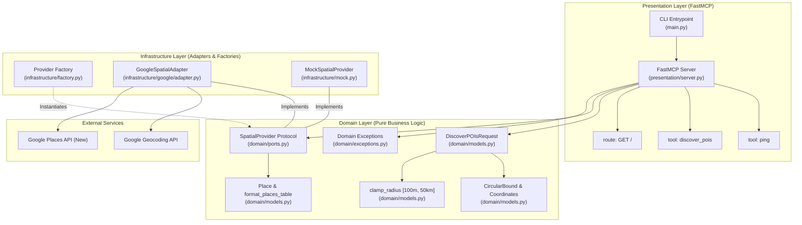

# System Design Document: Paridhi (परिधि)

*   **Author:** Anshul Patel
*   **Status:** Approved / Living Implementation Architecture
*   **Date:** 2026-11-06

--------------------------------------------------------------------------------

## Overview

**Paridhi** (*परिधि* — Sanskrit for *perimeter*, *circumference*, or *boundary*) is a [Model Context Protocol (MCP)](https://modelcontextprotocol.io/) server built in Python using [FastMCP](https://github.com/jlowin/fastmcp). It enables AI agents to discover, validate, and enrich local points of interest (POIs) strictly confined within circular spatial perimeters using Google Maps Platform services (Geocoding API & Places API New).

This document captures the architectural foundation, design decisions, domain invariants, and operational characteristics of the Paridhi codebase.

--------------------------------------------------------------------------------

## The Problem

Large Language Model (LLM) agents tasked with spatial navigation and local discovery face three recurring challenges when interacting with geospatial APIs:

1.  **Unbounded Geofencing**: Naive LLM prompts often request either excessively narrow radii (e.g., 5 meters) or unmanageably large areas (e.g., 500 kilometers), resulting in upstream API failures, quota exhaustion, or noisy, non-local results.
2.  **Excessive API Billing & Payload Overhead**: Querying modern geospatial APIs without field filtering returns bulky payloads (photos, reviews, full opening hour matrices) that consume significant token context windows and drive up API consumption costs.
3.  **Fragile Error Handling**: When an external API returns a 404, rate limit (429), or authentication error, raw exceptions bubble up as unhandled tracebacks to LLM agents, derailing agentic reasoning loops.

Paridhi solves these challenges by implementing an MCP server with automated radius clamping (`[100m, 50,000m]`), post-retrieval Haversine distance perimeter validation, explicit field masking (`PLACES_FIELD_MASK`), and an exception boundary that translates upstream failures into structured, actionable Markdown feedback.

--------------------------------------------------------------------------------

## Goals

*   **Strict Circular Perimeter Enforcement**: Automatically clamp all input radii to `[100.0, 50,000.0]` meters, and apply great-circle Haversine distance filtering on returned places.
*   **Hexagonal / Ports & Adapters Architecture**: Completely isolate domain logic and presentation layers from concrete geospatial service vendors via an abstract `SpatialProvider` protocol.
*   **Billing & Token Optimization**: Restrict upstream Google Places API (New) responses strictly to required attributes via `X-Goog-FieldMask` headers.
*   **Deterministic Offline Development**: Provide a credential-free `MockSpatialProvider` for local testing and CI/CD without network requests.
*   **Deep-Linked Markdown Presentation**: Format discovered places as clean Markdown tables with direct links to Google Maps pins and verified ratings.
*   **Resilient Error Interception**: Trap all geocoding, rate-limiting, and network failures at the presentation layer and format them as Markdown notices rather than uncaught Python exceptions.
*   **Multi-Transport Support**: Support FastMCP execution over `stdio`, `http`, `streamable-http`, and `sse`.
*   **Continuous Documentation Synchronization**: Enforce zero documentation drift via automated tests (`tests/test_docs_sync.py`).

--------------------------------------------------------------------------------

## Non-Goals

*   **Arbitrary Polygonal Geofences**: Paridhi intentionally restricts bounding geometry to circular perimeters (center point + radius). Arbitrary GeoJSON polygons, bounding boxes (BBoxes), or multi-polygons are explicitly out of scope.
*   **Persistent Storage & Local Caching**: Paridhi does not maintain an internal database (SQLite, PostgreSQL, Redis) for caching places across requests. Upstream caching compliance with Google Maps Platform Terms of Service is maintained by relying on transient requests.
*   **Direct Transactional Booking**: Paridhi does not handle table reservations, food ordering, or payments; it produces navigational deep links (`[Pin](...)`, `[Rating](...)`).

--------------------------------------------------------------------------------

## Open Questions

*   *All initial architectural decisions are resolved in the current 0.1.0 release.* Future considerations around client-side caching limits and rate-limit backoff are captured in [Future Improvements](#future-improvements).

--------------------------------------------------------------------------------

## Critical User Journeys (CUJs)

### CUJ 1: POI Discovery via Informal Neighborhood String

*   **Given**: An agent executing a tool call with `query="vadapav shops"`, `location="Bhatta, Paldi"`, and `radius_meters=3000`.
*   **When**: `discover_pois` is called on the FastMCP server.
*   **Then**:
    1.  `DiscoverPOIsRequest` validates the input and validates the search origin.
    2.  `SpatialProvider.geocode("Bhatta, Paldi")` resolves the address into `Coordinates(lat=23.0125, lng=72.5635)`.
    3.  `SpatialProvider.search_places` queries Google Places API (New) with field mask and location bias circle.
    4.  Haversine distance filter discards any place with distance $> \text{radius} \times 1.15$.
    5.  A Markdown table containing place names, addresses, Google Map pin links, and star ratings is returned to the client.

### CUJ 2: Direct Coordinate Search with Radius Clamping

*   **Given**: An agent invoking `discover_pois` with explicit `latitude=23.0225`, `longitude=72.5714`, and an out-of-bounds radius `radius_meters=50` (or `80,000`).
*   **When**: `DiscoverPOIsRequest` is instantiated.
*   **Then**:
    1.  `clamp_radius` clamps the radius to `100.0m` (or `50,000.0m`).
    2.  Geocoding is bypassed because direct coordinates were provided.
    3.  Places are searched within the clamped perimeter.
    4.  The generated Markdown response appends a note: `_Note: Radius was adjusted from 50m to minimum 100m._`.

### CUJ 3: Offline Development & CI Verification

*   **Given**: An environment without a `GOOGLE_MAPS_API_KEY` or running inside an isolated CI test runner.
*   **When**: `PARIDHI_SPATIAL_PROVIDER="mock"` is configured, or tests inject `MockSpatialProvider()`.
*   **Then**:
    1.  `get_spatial_provider()` returns `MockSpatialProvider`.
    2.  Geocoding and place searches resolve deterministically against `SAMPLE_PLACES` in Ahmedabad.
    3.  Zero external network calls or billing events occur.

### CUJ 4: Upstream Rate Limit or Provider Outage Handling

*   **Given**: Upstream Google Maps Platform returns HTTP 429 (`RESOURCE_EXHAUSTED`) or network timeout.
*   **When**: `GoogleSpatialAdapter.search_places` executes.
*   **Then**:
    1.  Adapter intercepts the error and raises `ProviderQuotaExceededError` or `ProviderTimeoutError`.
    2.  Presentation layer traps the exception and returns: `⚠️ **Quota Exceeded**: Provider quota exceeded. ...`.
    3.  The agent receives a graceful explanation without an unhandled traceback.

--------------------------------------------------------------------------------

## Technical Plan (Architecture)

### Architectural Pattern: Hexagonal (Ports & Adapters)

Paridhi enforces strict separation of concerns into four concentric layers:



### Component Breakdown

1.  **Core (`src/paridhi/core/`)**:
    *   `config.py`: Centralized `Settings` schema derived from `pydantic-settings`. Loads environment variables with prefix `PARIDHI_`, handles API key alias resolution, and exports cached singleton `get_settings()`.
2.  **Domain (`src/paridhi/domain/`)**:
    *   `ports.py`: Defines runtime-checkable `SpatialProvider` protocol with asynchronous methods `geocode()` and `search_places()`.
    *   `models.py`: Immutable data models (`Coordinates`, `CircularBound`, `Place`, `DiscoverPOIsRequest`). Enforces radius clamping (`[100m, 50,000m]`), origin presence validation, and Markdown table rendering (`format_places_table`).
    *   `exceptions.py`: Typed hierarchy rooted at `ParidhiError` with granular branches for validation, domain rules, and upstream provider faults.
3.  **Infrastructure (`src/paridhi/infrastructure/`)**:
    *   `factory.py`: `get_spatial_provider()` inspects settings and instantiates the appropriate adapter (`mock` or `google`).
    *   `google/adapter.py`: `GoogleSpatialAdapter` implements `SpatialProvider`. Makes asynchronous HTTP calls via `httpx.AsyncClient` with `PLACES_FIELD_MASK` and computes Haversine distance filtering.
    *   `mock.py`: `MockSpatialProvider` provides offline fixture data for reproducible testing.
4.  **Presentation (`src/paridhi/presentation/`)**:
    *   `server.py`: Instantiates `FastMCP`, registers MCP tools (`ping`, `discover_pois`), handles dependency injection, and wraps all tool executions in domain error boundaries.
5.  **Entrypoint (`src/paridhi/main.py`)**:
    *   Parses CLI arguments (`--transport`, `--host`, `--port`, `--debug`), configures structured stderr logging, and starts the server runner.

--------------------------------------------------------------------------------

## Alternatives Considered

### Alternative 1: Direct Coupling to Official Google Maps Python SDK (`googlemaps`)

*   **Pros**: Official SDK maintained by Google; built-in request retries.
*   **Cons**: Synchronous blocking architecture (incompatible with modern async FastMCP event loop); does not support Google Places API (New) Text Search endpoints; pulls heavy transitive dependencies.
*   **Reason for Rejection**: Rejected in favor of modern `httpx.AsyncClient` targeting the modern Places API (New) with explicit HTTP field masks.

### Alternative 2: OpenStreetMap (OSM) / Overpass API as Primary Provider

*   **Pros**: Completely open-source, no API keys or billing required.
*   **Cons**: Overpass QL queries have high latency (often 2–10 seconds), strict public server rate limits, and spotty global metadata (ratings, formatted addresses, Google Maps URLs).
*   **Reason for Rejection**: The primary product requirement is reliable, rich POI metadata with direct map pin and rating links. However, the `SpatialProvider` port was designed specifically so an OSM/Nominatim adapter can be added in the future without domain changes.

### Alternative 3: Returning Raw JSON Payloads vs. Formatted Markdown Tables

*   **Pros**: Raw JSON is directly machine-readable.
*   **Cons**: LLM agents often dump raw JSON directly to users or consume excessive context window tokens interpreting JSON arrays.
*   **Reason for Rejection**: Markdown tables with deep-linked pins provide immediate visual value to end users through AI chat interfaces while remaining easily parsable by downstream reasoning models.

--------------------------------------------------------------------------------

## Non-Functional Requirements

### Security & Privacy
*   **API Key Protection**: API keys are loaded via environment variables (`PARIDHI_GOOGLE_MAPS_API_KEY` or `GOOGLE_MAPS_API_KEY`) and never logged, echoed in error messages, or transmitted to MCP clients.
*   **No PII Storage**: Paridhi does not log or persist user queries, locations, or IP addresses.
*   **Strict Container Security**: Production multi-stage Docker build runs under a dedicated unprivileged user (`paridhi:10001`) with read-only root filesystems where appropriate.

### Performance & Latency
*   **Lean Field Masks**: Upstream Places API queries request only 6 explicit fields (`PLACES_FIELD_MASK`), avoiding megabytes of metadata per search.
*   **Async I/O**: All network requests utilize non-blocking `httpx.AsyncClient`.
*   **Configurable Timeout**: Default timeout is set to 10 seconds (`http_timeout_seconds=10.0`), preventing hung agent connections.

### Resilience & Fault Tolerance
*   **No Unhandled Tracebacks**: All exceptions inside tool handlers are intercepted by presentation error guards and converted to user-facing Markdown warnings.
*   **Offline Mode**: Test suite runs 100% offline using `MockSpatialProvider`.

--------------------------------------------------------------------------------

## Detailed Implementation & Verification Plan

### File Layout

*   `src/paridhi/main.py`: CLI dispatcher and logging setup.
*   `src/paridhi/core/config.py`: Configuration singleton and environment bindings.
*   `src/paridhi/domain/ports.py`: `SpatialProvider` abstract port protocol.
*   `src/paridhi/domain/models.py`: Domain entities, spatial clamping, and table formatter.
*   `src/paridhi/domain/exceptions.py`: Typed exception hierarchy.
*   `src/paridhi/infrastructure/factory.py`: Provider dependency injection factory.
*   `src/paridhi/infrastructure/mock.py`: Offline mock provider.
*   `src/paridhi/infrastructure/google/adapter.py`: Google Geocoding and Places API (New) adapter.
*   `src/paridhi/presentation/server.py`: FastMCP tools and error boundary handlers.

### Verification Plan

```bash
# 1. Run unit and integration tests (including docs sync verification)
uv run pytest

# 2. Verify static formatting and linting
uv run ruff check .
uv run ruff format --check .

# 3. Verify strict static typing
uv run mypy src tests
```

### Future Improvements

*   **Client-side Geocoding Cache**: Transient in-memory LRU cache for frequent neighborhood coordinates to reduce repetitive geocoding API calls.
*   **Additional Spatial Adapters**: Add `MapboxSpatialAdapter` and `NominatimSpatialAdapter` conforming to `SpatialProvider`.
*   **Exponential Backoff Retries**: Add configurable retry policies for transient HTTP network drops.

--------------------------------------------------------------------------------

*Drafted with EGM*
